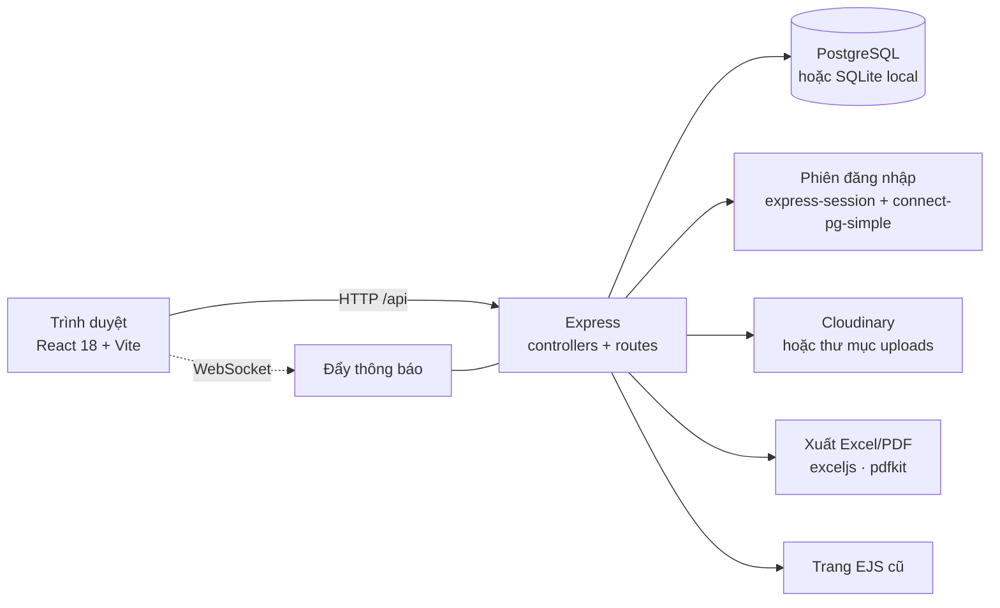
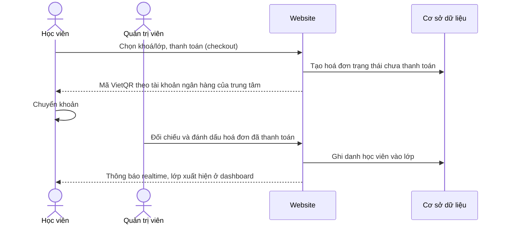
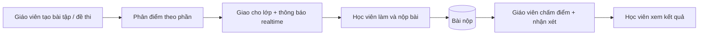
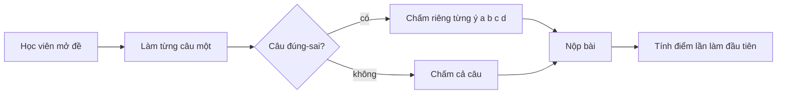
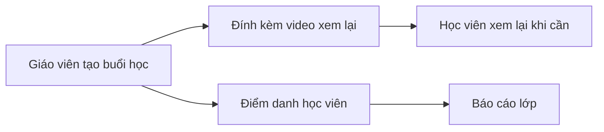
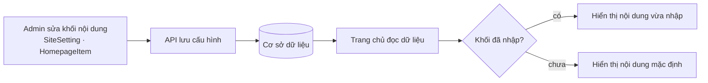

<div align="center">

# 🏫 Quản Lý Trung Tâm

**Hệ thống quản lý trung tâm dạy thêm: lớp học, bài tập, thanh toán và thông báo realtime**

Khoá học & lớp · Buổi học & điểm danh · Giao bài, chấm điểm · Hoá đơn · Trang chủ tự chỉnh


</div>

---

## Mục lục

1. [Giới thiệu](#1-giới-thiệu)
2. [Tính năng nổi bật](#2-tính-năng-nổi-bật)
3. [Vai trò người dùng](#3-vai-trò-người-dùng)
4. [Kiến trúc hệ thống](#4-kiến-trúc-hệ-thống)
5. [Các luồng hoạt động](#5-các-luồng-hoạt-động)
6. [Mô hình dữ liệu](#6-mô-hình-dữ-liệu)
7. [Hạn chế đã biết](#7-hạn-chế-đã-biết)
8. [Tài liệu kỹ thuật chi tiết](#8-tài-liệu-kỹ-thuật-chi-tiết)

---

## 1. Giới thiệu

**Quản Lý Trung Tâm** là ứng dụng web cho một trung tâm dạy thêm ở Việt Nam. Hệ thống phục vụ trọn vòng đời một lớp học:

- **Quản trị viên / nhân viên** mở khoá, lập lớp, ghi danh học viên, lập hoá đơn và biên tập nội dung trang chủ.
- **Giáo viên** quản lý lớp của mình: buổi học, điểm danh, giao bài tập và đề kiểm tra, chấm điểm, nhận xét.
- **Học viên** xem lịch học, xem lại video buổi học, làm bài, làm đề, xem kết quả và nhận thông báo.

Giao diện bằng tiếng Việt. Một máy chủ Express phục vụ cả giao diện React (chính) lẫn các trang EJS cũ chưa chuyển.

## 2. Tính năng nổi bật

**Dạy và học**
- Khoá học → lớp học → ghi danh, có phân quyền học viên theo từng lớp.
- Buổi học kèm **video xem lại** và **điểm danh**.
- Bài tập **tự luận** và **trắc nghiệm**, chia điểm theo từng phần.
- Đề kiểm tra làm **từng câu một**, chấm riêng từng ý a/b/c/d của câu đúng-sai, chỉ tính điểm lần làm đầu, có in và tải về.
- Giáo viên nhận xét và đánh giá bài đã nộp.

**Quản trị**
- Quản lý học viên, giáo viên (hồ sơ, ảnh đại diện).
- **Thông báo realtime** qua WebSocket: toàn hệ thống, theo lớp hoặc theo người.
- Hoá đơn, thanh toán, nhật ký thao tác (audit log), xuất Excel và PDF.
- Trang **Doanh thu & Báo cáo**, có dữ liệu demo cho môi trường local.
- Cửa hàng sách: danh mục, giỏ hàng, đơn mua sách.

**Nội dung trang chủ tự chỉnh**
- Banner, đếm ngược, giới thiệu, giáo viên tiêu biểu, slide, thành tích, phản hồi, khoá học và thông tin liên hệ chân trang đều sửa trong trang quản trị. Khối nào chưa nhập thì dùng nội dung mặc định.

## 3. Vai trò người dùng

| Vai trò | Khu vực | Quyền chính |
| --- | --- | --- |
| Quản trị viên (`ADMIN`) | Dashboard quản trị | Toàn quyền: người dùng, khoá, lớp, hoá đơn, nội dung trang chủ |
| Nhân viên (`STAFF`) | Dashboard quản trị | Quản lý khoá và lớp, quyền tài chính giới hạn |
| Giáo viên (`TEACHER`) | Dashboard giáo viên | Chỉ lớp của mình: buổi học, điểm danh, bài tập, chấm điểm, nhận xét |
| Học viên (`STUDENT`) | Dashboard học viên | Lịch học, video xem lại, bài tập, đề thi, kết quả |

Quyền được kiểm tra ở phía máy chủ. Vai trò phụ huynh đã bị gỡ bỏ.

## 4. Kiến trúc hệ thống



Cùng một mô hình Sequelize chạy trên PostgreSQL (production) và SQLite (máy local, không cần cài database). Triển khai một dịch vụ duy nhất trên Render.

## 5. Các luồng hoạt động

### 5.1. Từ mở khoá đến học viên vào lớp



Thanh toán là **chuyển khoản, xác nhận thủ công**; chưa có cổng thanh toán hay webhook ngân hàng.

### 5.2. Giáo viên giao bài và chấm điểm



### 5.3. Làm đề kiểm tra



### 5.4. Buổi học và điểm danh



### 5.5. Biên tập trang chủ



## 6. Mô hình dữ liệu

```mermaid
erDiagram
    User ||--o{ ClassStudent : "ghi danh"
    Class ||--o{ ClassStudent : "có"
    Course ||--o{ Class : "gồm"
    Class ||--o{ Lesson : "có buổi"
    Lesson ||--o{ Attendance : "điểm danh"
    Class ||--o{ Assignment : "giao"
    Assignment ||--o{ Submission : "nhận"
    User ||--o{ Submission : "nộp"
    User ||--o{ Invoice : "thanh toán"
    Invoice ||--o{ Payment : "ghi nhận"
    User ||--o{ Notification : "nhận"
```

| Nhóm | Bảng |
| --- | --- |
| Tài khoản | `User`, `UserProfile` |
| Học tập | `Course`, `Class`, `ClassStudent`, `Lesson`, `Attendance` |
| Bài tập | `Assignment`, `Submission`, `TeacherEvaluation` |
| Tài chính | `Invoice`, `Payment`, `AuditLog` |
| Sách | `Book`, `BookOrder`, `BookOrderItem` |
| Nội dung & thông báo | `SiteSetting`, `HomepageItem`, `Notification` |
| Tư vấn (rule-based) | `AiChatSession`, `AiChatMessage`, `UserLearningProfile` |

## 7. Hạn chế đã biết

- **Chat tư vấn không phải AI**: khớp từ khoá và số điện thoại để trả lời mẫu, không gọi mô hình ngôn ngữ.
- **Thanh toán thủ công**: chưa có cổng thanh toán hay webhook.
- `tailieuchucnang.md` là bản đặc tả mong muốn, gồm cả tính năng chưa làm.

---

## 8. Tài liệu kỹ thuật chi tiết

### Công nghệ

| Lớp | Lựa chọn |
|-----|----------|
| Backend | Node.js 22, Express, Sequelize |
| Cơ sở dữ liệu | PostgreSQL khi chạy thật, SQLite ở máy local (cùng một bộ model) |
| Frontend | React 18 + Vite, React Router, Axios |
| Giao diện render phía máy chủ | EJS (giữ song song với SPA) |
| Phiên đăng nhập | express-session trên connect-pg-simple |
| Realtime | `ws` để đẩy thông báo |
| Lưu ảnh/video | Cloudinary, dự phòng thư mục `uploads/` |
| Xuất file | exceljs, pdfkit |
| Hosting | Render (một dịch vụ, xem `render.yaml`) |

React SPA và các trang EJS cũ cùng được một ứng dụng Express phục vụ. SPA là giao diện chính; EJS còn lại cho những trang chưa chuyển.

### Cài đặt và chạy

Cần Node.js 22 trở lên. Chạy local không cần cài database, tự dùng SQLite.

```bash
npm install     # cài root, backend và frontend
npm run seed    # dữ liệu mẫu: người dùng, giáo viên, học viên, khoá học
npm run dev     # chạy backend và frontend cùng lúc
```

Frontend chạy ở http://localhost:5173 và chuyển tiếp API sang backend ở cổng 3001.

Tài khoản demo, mật khẩu chung `123456`:

| Vai trò | Đăng nhập |
|---------|-----------|
| Admin | `admin@trungtam.com` |
| Giáo viên | `nvnguyen@gmail.com` |
| Học viên | `quyen27@gmail.com` |

Seed chạy một lần: bỏ qua nếu database đã có người dùng. Đặt `SEED_FORCE=true` để seed lại.

### Dữ liệu doanh thu demo

`node backend/src/utils/seedDemoRevenue.js` điền vào SQLite local khoảng 3 tháng học viên, đơn hàng và thanh toán mẫu để trang **Doanh thu & Báo cáo** có dữ liệu (`--reset` tạo lại, `--clear` xoá hết; mọi bản ghi đều gắn nhãn `DEMO`). Lệnh từ chối chạy khi có `DATABASE_URL`, nên không thể chạm vào database trên Render.

### Các lệnh

| Lệnh | Tác dụng |
|------|----------|
| `npm run dev` | Backend và frontend, tự nạp lại khi sửa |
| `npm start` | Chạy thật: Express phục vụ bản SPA đã build |
| `npm run build` | Build frontend vào `frontend/dist` |
| `npm run seed` | Nạp dữ liệu mẫu |
| `npm test --prefix backend` | Kiểm thử backend (`node --test`) |

### Cấu hình

Sao chép `backend/.env.example` thành `backend/.env`. Chạy local thì biến nào cũng không bắt buộc.

| Biến | Công dụng |
|------|-----------|
| `PORT`, `NODE_ENV` | Cấu hình máy chủ cơ bản |
| `DB_DIALECT`, `DATABASE_URL` | Kết nối Postgres; bỏ trống thì dùng SQLite |
| `SESSION_SECRET` | Khoá ký phiên đăng nhập, phải đặt giá trị thật khi chạy thật |
| `CLOUDINARY_*` | Kho lưu ảnh/video; bỏ trống thì lưu vào `uploads/` |
| `VNP_*` | Trang checkout có đọc, nhưng cổng thanh toán chưa được nối |

Nếu `DATABASE_URL` trỏ tới máy không còn phân giải được, ứng dụng ghi log rồi tự chuyển sang SQLite thay vì từ chối khởi động.

### Cấu trúc thư mục

```
backend/
  server.js            điểm vào, nạp dữ liệu mẫu lần chạy đầu
  src/
    models/            các model Sequelize
    controllers/       mỗi khu vực một file: admin, auth, home, student, teacher, …
    routes/            các router Express
    views/             trang EJS giữ lại từ trước khi có SPA
frontend/
  src/pages/           trang React, chia theo vai trò
  src/components/
docs/                  đặc tả thiết kế và kế hoạch triển khai
render.yaml            nguồn cấu hình triển khai duy nhất
```

### Triển khai

Triển khai lên Render dưới dạng một dịch vụ. `render.yaml` là cấu hình chuẩn: dịch vụ tạo tay sẽ bỏ qua file này và build lỗi. Xem [DEPLOY_RENDER.md](DEPLOY_RENDER.md).

### Đóng góp

Cách đặt tên nhánh, kiểu commit, quy trình PR và phát hành nằm trong [CONTRIBUTING.md](CONTRIBUTING.md). Nhánh `main` được bảo vệ: mọi thay đổi phải qua pull request và CI xanh.

Các nhánh `phase/*` chỉ đọc, đánh dấu lịch sử trước khi có quy trình này, mỗi nhánh một giai đoạn làm việc. Đây không phải nhánh phát triển đang dùng.
