# 🏫 Quản Lý Trung Tâm

**Hệ thống quản lý trung tâm dạy thêm: lớp học, bài tập, thanh toán và thông báo realtime**

Khoá học & lớp · Buổi học · Giao bài, chấm điểm · Đề kiểm tra · Hoá đơn · Trang chủ tự chỉnh

---

## Mục lục

1. [Giới thiệu](#1-giới-thiệu)
2. [Tính năng nổi bật](#2-tính-năng-nổi-bật)
3. [Vai trò người dùng](#3-vai-trò-người-dùng)
4. [Kiến trúc hệ thống](#4-kiến-trúc-hệ-thống)
5. [Các luồng hoạt động](#5-các-luồng-hoạt-động)
6. [Hạn chế đã biết](#6-hạn-chế-đã-biết)

---

## 1. Giới thiệu

**Quản Lý Trung Tâm** là ứng dụng web cho một trung tâm dạy thêm ở Việt Nam. Hệ thống phục vụ trọn vòng đời một lớp học:

- **Quản trị viên / nhân viên** mở khoá, lập lớp, ghi danh học viên, lập hoá đơn và biên tập nội dung trang chủ.
- **Giáo viên** quản lý lớp của mình: buổi học, điểm danh, giao bài tập và đề kiểm tra, chấm điểm, nhận xét.
- **Học viên** xem lịch học, xem lại video buổi học, làm bài, làm đề, xem kết quả và nhận thông báo.

Giao diện bằng tiếng Việt.

## 2. Tính năng nổi bật

**Dạy và học**
- Khoá học → lớp học → ghi danh, có phân quyền học viên theo từng lớp.
- Buổi học kèm **video xem lại** và **điểm danh**.
- Bài tập **tự luận** và **trắc nghiệm**, chia điểm theo từng phần.
- Đề kiểm tra làm **từng câu một**, chấm riêng từng ý a/b/c/d của câu đúng-sai, chỉ tính điểm lần làm đầu, có in và tải về.
- Giáo viên nhận xét và đánh giá bài đã nộp.

**Quản trị**
- Quản lý học viên, giáo viên (hồ sơ, ảnh đại diện).
- **Thông báo realtime** qua WebSocket: toàn hệ thống, theo lớp hoặc theo người; **tự nhắc lịch học trước 24 giờ**.
- Hoá đơn, thanh toán, xuất Excel và PDF.
- Trang **Doanh thu & Báo cáo**.
- Cửa hàng sách: danh mục, giỏ hàng, đơn mua sách.

**Nội dung trang chủ tự chỉnh**
- Banner, đếm ngược, giới thiệu, giáo viên tiêu biểu, slide, thành tích, phản hồi, khoá học và thông tin liên hệ chân trang đều sửa trong trang quản trị. Khối nào chưa nhập thì dùng nội dung mặc định.

## 3. Vai trò người dùng

| Vai trò | Quyền chính |
| --- | --- |
| Quản trị viên | Toàn quyền: người dùng, khoá, lớp, hoá đơn, nội dung trang chủ |
| Nhân viên | Quản lý khoá và lớp, quyền tài chính giới hạn |
| Giáo viên | Chỉ lớp của mình: buổi học, điểm danh, bài tập, chấm điểm, nhận xét |
| Học viên | Lịch học, video xem lại, bài tập, đề thi, kết quả |

## 4. Kiến trúc hệ thống

> Các sơ đồ bên dưới là ảnh SVG động: chấm sáng chạy dọc mũi tên theo từng bước, node được tô sáng khi dữ liệu tới.

## 5. Các luồng hoạt động

### 5.1. Từ chọn lớp đến vào học

Thanh toán bằng chuyển khoản; học viên chỉ được xếp vào lớp sau khi admin đối chiếu và xác nhận hoá đơn.

### 5.2. Giáo viên giao bài và chấm điểm

### 5.3. Làm đề kiểm tra

Câu đúng-sai được chấm riêng từng ý, và chỉ lần làm đầu tiên được tính điểm.

### 5.4. Thông báo realtime và nhắc lịch học tự động

Hai đường cùng đổ về một kênh: thông báo phát sinh từ sự kiện, và job chạy nền mỗi 10 phút tìm các buổi học trong 24 giờ tới để nhắc. Mỗi buổi chỉ được nhắc đúng một lần dù job chạy nhiều lần.

### 5.5. Biên tập nội dung trang chủ

## 6. Hạn chế đã biết

- **Chat tư vấn không phải AI**: khớp từ khoá và số điện thoại để trả lời mẫu, không gọi mô hình ngôn ngữ.
- **Thanh toán thủ công**: chưa có cổng thanh toán hay webhook ngân hàng.
