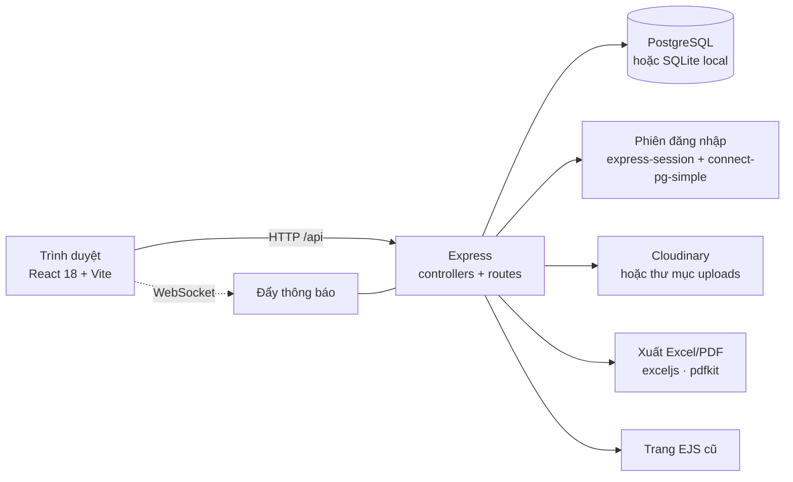
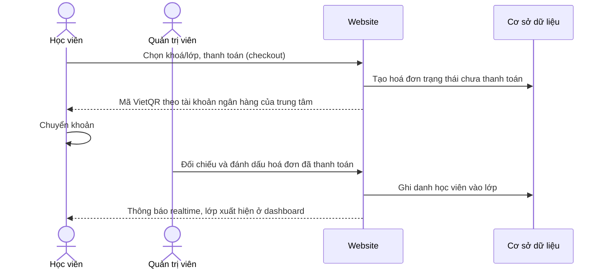
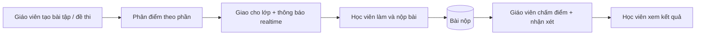
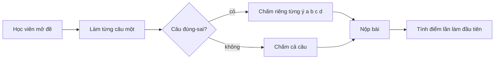
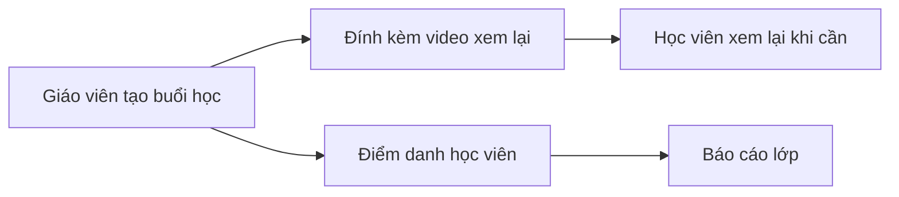
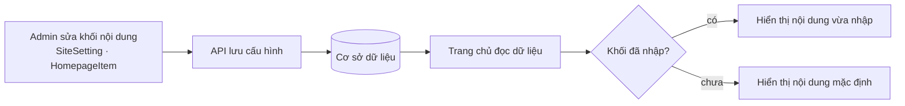

<div align="center">

# 🏫 Quản Lý Trung Tâm

**Hệ thống quản lý trung tâm dạy thêm: lớp học, bài tập, thanh toán và thông báo realtime**

Khoá học & lớp · Buổi học & điểm danh · Giao bài, chấm điểm · Hoá đơn · Trang chủ tự chỉnh


</div>

---

## Mục lục

1. [Giới thiệu](#1-giới-thiệu)
2. [Tính năng nổi bật](#2-tính-năng-nổi-bật)
3. [Vai trò người dùng](#3-vai-trò-người-dùng)
4. [Kiến trúc hệ thống](#4-kiến-trúc-hệ-thống)
5. [Các luồng hoạt động](#5-các-luồng-hoạt-động)
6. [Mô hình dữ liệu](#6-mô-hình-dữ-liệu)
7. [Hạn chế đã biết](#7-hạn-chế-đã-biết)
8. [Tài liệu kỹ thuật chi tiết (English)](#technical-reference)

---

## 1. Giới thiệu

**Quản Lý Trung Tâm** là ứng dụng web cho một trung tâm dạy thêm ở Việt Nam. Hệ thống phục vụ trọn vòng đời một lớp học:

- **Quản trị viên / nhân viên** mở khoá, lập lớp, ghi danh học viên, lập hoá đơn và biên tập nội dung trang chủ.
- **Giáo viên** quản lý lớp của mình: buổi học, điểm danh, giao bài tập và đề kiểm tra, chấm điểm, nhận xét.
- **Học viên** xem lịch học, xem lại video buổi học, làm bài, làm đề, xem kết quả và nhận thông báo.

Giao diện bằng tiếng Việt. Một máy chủ Express phục vụ cả giao diện React (chính) lẫn các trang EJS cũ chưa chuyển.

## 2. Tính năng nổi bật

**Dạy và học**
- Khoá học → lớp học → ghi danh, có phân quyền học viên theo từng lớp.
- Buổi học kèm **video xem lại** và **điểm danh**.
- Bài tập **tự luận** và **trắc nghiệm**, chia điểm theo từng phần.
- Đề kiểm tra làm **từng câu một**, chấm riêng từng ý a/b/c/d của câu đúng-sai, chỉ tính điểm lần làm đầu, có in và tải về.
- Giáo viên nhận xét và đánh giá bài đã nộp.

**Quản trị**
- Quản lý học viên, giáo viên (hồ sơ, ảnh đại diện).
- **Thông báo realtime** qua WebSocket: toàn hệ thống, theo lớp hoặc theo người.
- Hoá đơn, thanh toán, nhật ký thao tác (audit log), xuất Excel và PDF.
- Trang **Doanh thu & Báo cáo**, có dữ liệu demo cho môi trường local.
- Cửa hàng sách: danh mục, giỏ hàng, đơn mua sách.

**Nội dung trang chủ tự chỉnh**
- Banner, đếm ngược, giới thiệu, giáo viên tiêu biểu, slide, thành tích, phản hồi, khoá học và thông tin liên hệ chân trang đều sửa trong trang quản trị. Khối nào chưa nhập thì dùng nội dung mặc định.

## 3. Vai trò người dùng

| Vai trò | Khu vực | Quyền chính |
| --- | --- | --- |
| Quản trị viên (`ADMIN`) | Dashboard quản trị | Toàn quyền: người dùng, khoá, lớp, hoá đơn, nội dung trang chủ |
| Nhân viên (`STAFF`) | Dashboard quản trị | Quản lý khoá và lớp, quyền tài chính giới hạn |
| Giáo viên (`TEACHER`) | Dashboard giáo viên | Chỉ lớp của mình: buổi học, điểm danh, bài tập, chấm điểm, nhận xét |
| Học viên (`STUDENT`) | Dashboard học viên | Lịch học, video xem lại, bài tập, đề thi, kết quả |

Quyền được kiểm tra ở phía máy chủ. Vai trò phụ huynh đã bị gỡ bỏ.

## 4. Kiến trúc hệ thống



Cùng một mô hình Sequelize chạy trên PostgreSQL (production) và SQLite (máy local, không cần cài database). Triển khai một dịch vụ duy nhất trên Render.

## 5. Các luồng hoạt động

### 5.1. Từ mở khoá đến học viên vào lớp



Thanh toán là **chuyển khoản, xác nhận thủ công**; chưa có cổng thanh toán hay webhook ngân hàng.

### 5.2. Giáo viên giao bài và chấm điểm



### 5.3. Làm đề kiểm tra



### 5.4. Buổi học và điểm danh



### 5.5. Biên tập trang chủ



## 6. Mô hình dữ liệu

```mermaid
erDiagram
    User ||--o{ ClassStudent : "ghi danh"
    Class ||--o{ ClassStudent : "có"
    Course ||--o{ Class : "gồm"
    Class ||--o{ Lesson : "có buổi"
    Lesson ||--o{ Attendance : "điểm danh"
    Class ||--o{ Assignment : "giao"
    Assignment ||--o{ Submission : "nhận"
    User ||--o{ Submission : "nộp"
    User ||--o{ Invoice : "thanh toán"
    Invoice ||--o{ Payment : "ghi nhận"
    User ||--o{ Notification : "nhận"
```

| Nhóm | Bảng |
| --- | --- |
| Tài khoản | `User`, `UserProfile` |
| Học tập | `Course`, `Class`, `ClassStudent`, `Lesson`, `Attendance` |
| Bài tập | `Assignment`, `Submission`, `TeacherEvaluation` |
| Tài chính | `Invoice`, `Payment`, `AuditLog` |
| Sách | `Book`, `BookOrder`, `BookOrderItem` |
| Nội dung & thông báo | `SiteSetting`, `HomepageItem`, `Notification` |
| Tư vấn (rule-based) | `AiChatSession`, `AiChatMessage`, `UserLearningProfile` |

## 7. Hạn chế đã biết

- **Chat tư vấn không phải AI**: khớp từ khoá và số điện thoại để trả lời mẫu, không gọi mô hình ngôn ngữ.
- **Thanh toán thủ công**: chưa có cổng thanh toán hay webhook.
- `tailieuchucnang.md` là bản đặc tả mong muốn, gồm cả tính năng chưa làm.

---

<a id="technical-reference"></a>

# Technical reference (English)

## Stack

| Layer | Choice |
|-------|--------|
| Backend | Node.js 22, Express, Sequelize |
| Database | PostgreSQL in production, SQLite locally (same models) |
| Frontend | React 18 + Vite, React Router, Axios |
| Server-rendered views | EJS (kept alongside the SPA) |
| Sessions | express-session on connect-pg-simple |
| Realtime | `ws` for notification push |
| Media | Cloudinary, with a local `uploads/` fallback |
| Export | exceljs, pdfkit |
| Hosting | Render (single service, see `render.yaml`) |

Both the React SPA and the original EJS views are served by the same Express
app. The SPA is the primary interface; the EJS views remain for pages that
were never migrated.

## Roles

Four roles, enforced server-side (`ADMIN`, `STAFF`, `TEACHER`, `STUDENT`).
The parent role and its pages were removed; old parent accounts cannot sign in:

- **Admin** — full access: users, courses, classes, invoices, site content
- **Staff** — course and class administration, limited financial access
- **Teacher** — own classes: lessons, attendance, assignments, grading,
  feedback
- **Student** — schedule, lesson replays, assignments, exams, results

## What it does

**Teaching**
- Courses, classes and enrolment, with per-class student permissions
- Lessons with video replay and attendance tracking
- Assignments: essay and multiple-choice, per-section point allocation
- Exams: one question at a time, per-sub-item grading for true/false
  questions (a, b, c, d), print and download, first-attempt-only scoring
- Teacher feedback and evaluations on submitted work

**Administration**
- Student and teacher management, teacher profiles with avatars
- Notifications: system-wide, per-class or per-user, pushed over WebSocket
- Invoices and checkout, with an audit log
- Excel and PDF export

**Site content**
- The homepage (banner, countdown, introduction, featured teachers, slides,
  achievements, feedback, courses) and the footer contact details are stored
  in `SiteSetting` and `HomepageItem` and edited from the admin panel. Every
  block falls back to its original hardcoded content when unset.

## Known limitations

Two features are less complete than the older specification documents
suggest:

- **The advisor chat is rule-based, not AI.** `aiController` matches
  keywords and phone-number patterns to canned replies. It calls no language
  model, despite the `AiChatSession` and `UserLearningProfile` models.
- **Payment is bank transfer with manual confirmation.** Checkout creates an unpaid `Invoice`; the student pays by bank
  transfer (VietQR image built from the account set under Admin → Site settings) and is only enrolled in the class when an admin
  marks the invoice paid. There is no payment gateway or bank webhook, so confirmation is by hand.

`tailieuchucnang.md` describes the intended system, including features not
yet built. Treat it as a specification, not as documentation of what runs.

## Getting started

Requires Node.js 22 or newer. No database setup is needed for local
development; it falls back to SQLite.

```bash
npm install     # installs root, backend and frontend
npm run seed    # demo users, teachers, students and courses
npm run dev     # backend and frontend together
```

The frontend runs on http://localhost:5173 and proxies API calls to the
backend on port 3001.

Demo accounts, all with the password `123456`:

| Role | Login |
|------|-------|
| Admin | `admin@trungtam.com` |
| Teacher | `nvnguyen@gmail.com` |
| Student | `quyen27@gmail.com` |

Seeding is idempotent: it skips when the database already has users. Set
`SEED_FORCE=true` to reseed.

## Demo revenue data

`node backend/src/utils/seedDemoRevenue.js` fills the local SQLite database with ~3 months of sample students, orders and
payments so the **Doanh thu & Báo cáo** page has something to show (`--reset` regenerates, `--clear` removes it all; every
record is marked `DEMO`). It refuses to run when `DATABASE_URL` is set, so it can never touch the Render database.

## Scripts

| Command | Does |
|---------|------|
| `npm run dev` | Backend and frontend with hot reload |
| `npm start` | Production: Express serves the built SPA |
| `npm run build` | Builds the frontend into `frontend/dist` |
| `npm run seed` | Seeds demo data |
| `npm test --prefix backend` | Backend tests (`node --test`) |

## Configuration

Copy `backend/.env.example` to `backend/.env`. Everything is optional
locally.

| Variable | Purpose |
|----------|---------|
| `PORT`, `NODE_ENV` | Server basics |
| `DB_DIALECT`, `DATABASE_URL` | Postgres connection; unset means SQLite |
| `SESSION_SECRET` | Session signing key — set a real one in production |
| `CLOUDINARY_*` | Media storage; unset falls back to local `uploads/` |
| `VNP_*` | Read by the checkout views; the gateway is not yet wired up |

If `DATABASE_URL` points at a host that no longer resolves, the app logs the
problem and falls back to SQLite rather than refusing to start.

## Project layout

```
backend/
  server.js            entry point, seeds on first boot
  src/
    models/            Sequelize models
    controllers/       one per area: admin, auth, home, student, teacher, …
    routes/            Express routers
    views/             EJS pages kept from before the SPA
frontend/
  src/pages/           React pages, grouped by role
  src/components/
docs/                  design specs and implementation plans
render.yaml            the single source of deployment configuration
```

## Deployment

Deployed to Render as one service. `render.yaml` is authoritative — a
manually created service ignores it and will fail to build. See
[DEPLOY_RENDER.md](DEPLOY_RENDER.md).

## Contributing

Branch naming, commit style, the PR flow and releases are described in
[CONTRIBUTING.md](CONTRIBUTING.md). `main` is protected: every change goes
through a pull request with CI passing.

The `phase/*` branches are read-only markers on the history that predates
this workflow, one per period of work. They are not active development
branches.
