<div align="center">

# 🏫 Quản Lý Trung Tâm

**Hệ thống quản lý trung tâm dạy thêm: lớp học, bài tập, thanh toán và thông báo realtime**

Khoá học & lớp · Buổi học & điểm danh · Giao bài, chấm điểm · Hoá đơn · Trang chủ tự chỉnh


</div>

---

## Mục lục

1. [Giới thiệu](#1-giới-thiệu)
2. [Tính năng nổi bật](#2-tính-năng-nổi-bật)
3. [Vai trò người dùng](#3-vai-trò-người-dùng)
4. [Kiến trúc hệ thống](#4-kiến-trúc-hệ-thống)
5. [Các luồng hoạt động](#5-các-luồng-hoạt-động)
6. [Mô hình dữ liệu](#6-mô-hình-dữ-liệu)
7. [Hạn chế đã biết](#7-hạn-chế-đã-biết)

---

## 1. Giới thiệu

**Quản Lý Trung Tâm** là ứng dụng web cho một trung tâm dạy thêm ở Việt Nam. Hệ thống phục vụ trọn vòng đời một lớp học:

- **Quản trị viên / nhân viên** mở khoá, lập lớp, ghi danh học viên, lập hoá đơn và biên tập nội dung trang chủ.
- **Giáo viên** quản lý lớp của mình: buổi học, điểm danh, giao bài tập và đề kiểm tra, chấm điểm, nhận xét.
- **Học viên** xem lịch học, xem lại video buổi học, làm bài, làm đề, xem kết quả và nhận thông báo.

Giao diện bằng tiếng Việt. Một máy chủ Express phục vụ cả giao diện React (chính) lẫn các trang EJS cũ chưa chuyển.

## 2. Tính năng nổi bật

**Dạy và học**
- Khoá học → lớp học → ghi danh, có phân quyền học viên theo từng lớp.
- Buổi học kèm **video xem lại** và **điểm danh**.
- Bài tập **tự luận** và **trắc nghiệm**, chia điểm theo từng phần.
- Đề kiểm tra làm **từng câu một**, chấm riêng từng ý a/b/c/d của câu đúng-sai, chỉ tính điểm lần làm đầu, có in và tải về.
- Giáo viên nhận xét và đánh giá bài đã nộp.

**Quản trị**
- Quản lý học viên, giáo viên (hồ sơ, ảnh đại diện).
- **Thông báo realtime** qua WebSocket: toàn hệ thống, theo lớp hoặc theo người.
- Hoá đơn, thanh toán, nhật ký thao tác (audit log), xuất Excel và PDF.
- Trang **Doanh thu & Báo cáo**, có dữ liệu demo cho môi trường local.
- Cửa hàng sách: danh mục, giỏ hàng, đơn mua sách.

**Nội dung trang chủ tự chỉnh**
- Banner, đếm ngược, giới thiệu, giáo viên tiêu biểu, slide, thành tích, phản hồi, khoá học và thông tin liên hệ chân trang đều sửa trong trang quản trị. Khối nào chưa nhập thì dùng nội dung mặc định.

## 3. Vai trò người dùng

| Vai trò | Khu vực | Quyền chính |
| --- | --- | --- |
| Quản trị viên (`ADMIN`) | Dashboard quản trị | Toàn quyền: người dùng, khoá, lớp, hoá đơn, nội dung trang chủ |
| Nhân viên (`STAFF`) | Dashboard quản trị | Quản lý khoá và lớp, quyền tài chính giới hạn |
| Giáo viên (`TEACHER`) | Dashboard giáo viên | Chỉ lớp của mình: buổi học, điểm danh, bài tập, chấm điểm, nhận xét |
| Học viên (`STUDENT`) | Dashboard học viên | Lịch học, video xem lại, bài tập, đề thi, kết quả |

Quyền được kiểm tra ở phía máy chủ. Vai trò phụ huynh đã bị gỡ bỏ.

## 4. Kiến trúc hệ thống

> Các sơ đồ bên dưới là ảnh SVG động: chấm sáng chạy dọc mũi tên theo từng bước, node được tô sáng khi dữ liệu tới.

<p align="center"></p>

Cùng một mô hình Sequelize chạy trên PostgreSQL (production) và SQLite (máy local, không cần cài database). Triển khai một dịch vụ duy nhất trên Render.

## 5. Các luồng hoạt động

### 5.1. Từ mở khoá đến học viên vào lớp

<p align="center"></p>

Thanh toán là **chuyển khoản, xác nhận thủ công**; chưa có cổng thanh toán hay webhook ngân hàng.

### 5.2. Giáo viên giao bài và chấm điểm

<p align="center"></p>

### 5.3. Làm đề kiểm tra

<p align="center"></p>

### 5.4. Buổi học và điểm danh

<p align="center"></p>

### 5.5. Biên tập trang chủ

<p align="center"></p>

## 6. Mô hình dữ liệu

```mermaid
erDiagram
    User ||--o{ ClassStudent : "ghi danh"
    Class ||--o{ ClassStudent : "có"
    Course ||--o{ Class : "gồm"
    Class ||--o{ Lesson : "có buổi"
    Lesson ||--o{ Attendance : "điểm danh"
    Class ||--o{ Assignment : "giao"
    Assignment ||--o{ Submission : "nhận"
    User ||--o{ Submission : "nộp"
    User ||--o{ Invoice : "thanh toán"
    Invoice ||--o{ Payment : "ghi nhận"
    User ||--o{ Notification : "nhận"
```

| Nhóm | Bảng |
| --- | --- |
| Tài khoản | `User`, `UserProfile` |
| Học tập | `Course`, `Class`, `ClassStudent`, `Lesson`, `Attendance` |
| Bài tập | `Assignment`, `Submission`, `TeacherEvaluation` |
| Tài chính | `Invoice`, `Payment`, `AuditLog` |
| Sách | `Book`, `BookOrder`, `BookOrderItem` |
| Nội dung & thông báo | `SiteSetting`, `HomepageItem`, `Notification` |
| Tư vấn (rule-based) | `AiChatSession`, `AiChatMessage`, `UserLearningProfile` |

## 7. Hạn chế đã biết

- **Chat tư vấn không phải AI**: khớp từ khoá và số điện thoại để trả lời mẫu, không gọi mô hình ngôn ngữ.
- **Thanh toán thủ công**: chưa có cổng thanh toán hay webhook.
- `tailieuchucnang.md` là bản đặc tả mong muốn, gồm cả tính năng chưa làm.
